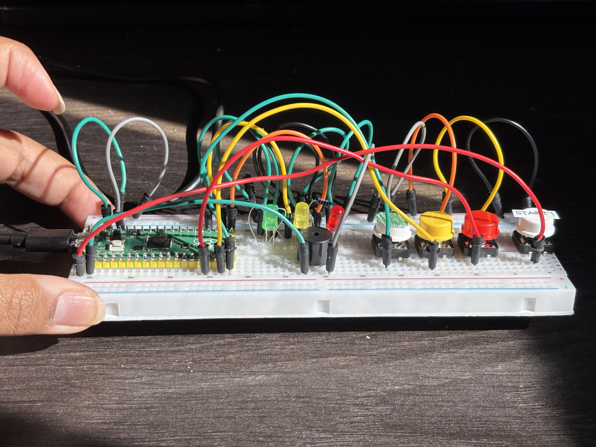
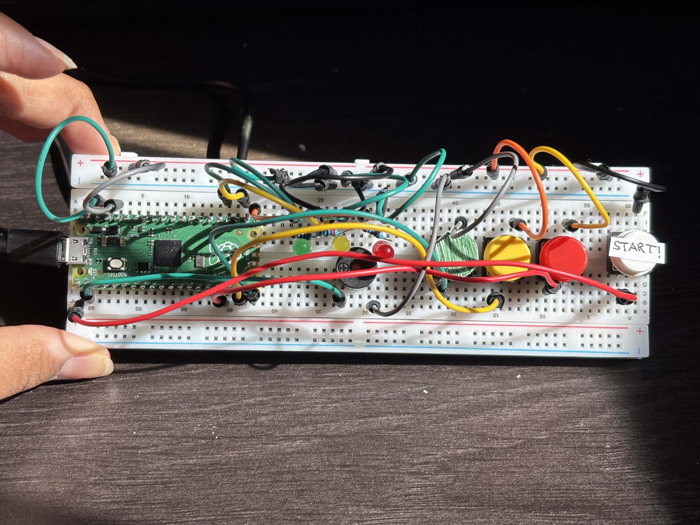

# Pico Simon Says Interactive Game

An interactive, hardware-based **Simon Says memory game** developed using the **Raspberry Pi Pico and MicroPython**.

The game challenges players to memorize and repeat increasingly complex LED sequences using physical push buttons. Each LED is paired with a distinct buzzer tone, providing both visual and auditory feedback throughout gameplay.

This project explores embedded systems programming, GPIO communication, PWM-based sound generation, hardware integration, and interactive game development.

## Project Objectives

- Develop an interactive memory game using the Raspberry Pi Pico.
- Interface physical input and output components using MicroPython.
- Implement randomized sequences and player input validation.
- Design a progressive difficulty system.
- Generate distinct sound frequencies using PWM.
- Integrate LEDs, push buttons, and a buzzer into an interactive circuit.
- Practice embedded programming and hardware troubleshooting.

## Hardware Components

| Component | Purpose |
|---|---|
| Raspberry Pi Pico | Main microcontroller |
| 3 LEDs (Red, Yellow, Green) | Display randomized color sequences |
| 4 Push Buttons | Three color inputs and one game-start button |
| Passive Buzzer | Produces color-specific tones, countdown beeps, and game-over sound |
| 220–330Ω Resistors | Limit current through LEDs |
| Breadboard | Circuit assembly |
| Jumper Wires | Hardware connections |

## How It Works

**1. Game Initialization**

The program waits for the player to press the start button. Once pressed, a three-second countdown begins, accompanied by buzzer sounds.

**2. Sequence Generation**

The Pico randomly selects one of three LEDs (red, yellow, or green) and adds it to the existing sequence.

Each LED illuminates alongside a distinct buzzer frequency:

| LED Color | Buzzer Frequency |
|---|---|
| 🔴 Red | 300 Hz |
| 🟡 Yellow | 500 Hz |
| 🟢 Green | 700 Hz |

**3. Player Input**

After displaying the sequence, the game waits for the player to reproduce it using the corresponding colored buttons.

**4. Sequence Validation**

The program compares each button press against the expected color in the generated sequence.

- **Correct input:** Continue to the next color or advance to the next round.
- **Incorrect input:** End the game and activate the game-over sound.

**5. Progressive Difficulty**

Each successful round adds another randomly selected LED to the sequence, increasing the memory challenge.

**6. Game Over**

If the player presses an incorrect button, the program displays `GAME OVER` in the console and activates a continuous two-second buzzer tone at 1000 Hz.

## Example Gameplay

| Round | LED Sequence |
|---|---|
| Level 1 | 🔴 |
| Level 2 | 🔴 → 🟢 |
| Level 3 | 🔴 → 🟢 → 🟡 |
| Level 4 | 🔴 → 🟢 → 🟡 → 🔴 |

The sequence continues growing until the player makes a mistake.

## GPIO Pin Configuration

| Component | GPIO Pin | Mode |
|---|---|---|
| Red LED | GP16 | Output |
| Yellow LED | GP17 | Output |
| Green LED | GP18 | Output |
| Red Button | GP13 | Input (Pull-down) |
| Yellow Button | GP14 | Input (Pull-down) |
| Green Button | GP15 | Input (Pull-down) |
| Start Button | GP0 | Input (Pull-down) |
| Buzzer | GP6 | PWM Output |

## Circuit Setup

The completed prototype integrates three colored push buttons, a dedicated start button, three LEDs, and a buzzer with the Raspberry Pi Pico.

<table>
  <tr>
    <td align="center" width="50%">
      
       
      <b>Complete Circuit Setup</b>
    </td>
    <td align="center" width="50%">
      
       
      <b>Simon Says Prototype</b>
    </td>
  </tr>
</table>

## Gameplay Demonstration

The following demonstration showcases the start-button countdown, randomized LED sequences, corresponding buzzer tones, player input, and game-over detection.

[▶️ Watch Simon Says Gameplay Demonstration](https://github.com/madhu1-byte/Simon-Says-Game/releases/download/v1.0.0/simon_says_game.mov)

## Technologies Used

- **MicroPython** — Embedded software development
- **Raspberry Pi Pico** — Microcontroller platform
- **Thonny IDE** — Code development and testing
- **GPIO** — Digital input/output control
- **PWM** — Buzzer frequency and sound generation
- **Python Random Module** — Randomized sequence generation

## Future Improvements

- Add an LCD display for real-time game status and scoring.
- Implement adjustable difficulty levels and sequence playback speeds.
- Add a restart feature without resetting the microcontroller.
- Introduce a high-score tracking system.
- Improve sound effects for successful rounds and game completion.
